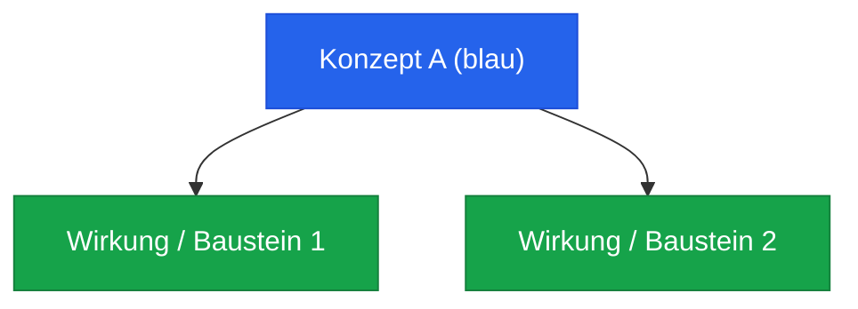

# Antwort-Layouts & Markdown-Vorlagen (AP-Lerncoach)

Diese Vorlagen kombinieren **Advance Organizer (BLUF)**, **Mayer's Multimedia-Prinzipien** (*Coherence, Segmenting, Signaling, Spatial Contiguity*), **farbcodiertes Dual Coding**, **Mnemonics/Eselsbrücken**, **Wenn-Dann-Regeln** und **Formatives Feedback** (*Hattie & Timperley 2007*) — maximal übersichtlich und token-sparend.

## Fester Farbcode (Semantisches Signaling)

| Marker | Bedeutung | Typischer Einsatz |
|---|---|---|
| 🔵 **Blau** | Prinzip / Logik / „Warum?“ | Kausalketten (`Ursache → Wirkung`), Struktur, `RAID 0` / Basiskonzept |
| 🟢 **Grün** | Sicher / Vorteil / Richtig / Standard | Lösung, Empfehlung, `> [!TIP]`-Boxen, korrekte Antwort |
| 🟡 **Gelb** | Merksatz / Eselsbrücke / Check / Achtung | Eselsbrücken, Prüfungsregeln (`> [!WARNING]`), Active-Recall-Check |
| 🔴 **Rot** | Gefahr / Fehler / Verlust / Falle | Prüfungsfallen, Totalverlust, typische Denkfehler |

---

## Layout 1: Farbcodierte Lernkarte (Modus „Verstehen & Erklären“)

Standard-Layout für Erklärungen: **fette Kurz-Antwort direkt ganz oben (ohne `[!info]`)**, farbiges Mini-Mermaid (~150 Tokens), Eselsbrücke, logische `Ursache → Wirkung`-Schritte, Kurz-Vergleich, Prüfungs-Regel und 1 kurzer Check.

````markdown
# <Thema>

**<1 Satz: Was macht der Oberbegriff / das Grundprinzip?>**

> 📌 **Definition (<Begriff>):** **<Präzise, fette Definition aus den Vault-Unterlagen mit wichtigen Schlüsselwörtern.>**

**<1 Satz: Was genau macht das konkrete Thema (mit 🔵/🟢 Farbmarkern und **fetten** Kernbegriffen)?>**



> [!TIP]
> **🟡 Eselsbrücke & Merksatz**
> - **<Konzept A>:** *„<Kurzer, klebriger Merksatz>“*
> - **<Konzept B>:** *„<Kurzer Kontrast-Merksatz>“*

## 🔵 Logik dahinter (Ursache → Wirkung)

1. **Warum <Prinzip 1>:** <Ursache mit **fetten Kernbegriffen**> → <Wirkung> *(ggf. Formel + 1 kurzes Praxisbeispiel)*.
2. **Was bei <Situation> passiert:** <Konkreter Mechanismus in 1–2 Zeilen>.
3. **Warum <Folge / Unterschied> entscheidet:** <Klares Ursache-Wirkung-Fazit mit 🟢/🔴>.

## Kurz-Vergleich *(bei 2+ Konzepten)*

| Kriterium | <Konzept A> | <Konzept B> |
|---|---|---|
| **Aufbau** | 🔵 <3–4 Wörter> | 🟢 <3–4 Wörter> |
| **Vorteil / Risiko** | 🔴 <3–4 Wörter> | 🟢 <3–4 Wörter> |
| **Praxis-Urteil** | 🔴 <Urteil> | 🟢 **<Standard>** |

> [!WARNING]
> **🟡 Prüfungs-Regeln (Wenn-Dann & Falle)**
> - **Wenn** <Bedingung> → 🟢 **immer <Regel>** *(kurzes Warum)*.
> - **🔴 <Typische Falle X ≠ Y>:** <1-Zeilen-Begründung, warum das verwechselt wird>.

## 🟡 Kurzer Check
**<Knackige Verständnis- oder Transferfrage in 1–2 Zeilen — ohne Spoiler!>**

---
**Quellen:** **<Fach (Lehrjahr)>** · `<Dateiname.pdf>` · **S. <X–Y> (von <N> Seiten)** *(Textstatus / OCR-Hinweis)* · *Ergänzung:* <falls didaktisch ergänzt>
````

---

## Layout 2: Worked Example → Fading (Modus „Rechenweg / Code / SQL“)

Verwenden bei neuen Verfahren (Subnetting, SQL, Java/Python, Bezugskalkulation, Deckungsbeitrag, Elektrotechnik, ER/UML).

```markdown
## Musterfall: <Verfahren>

**<1–2 fette Sätze: Welches Problem löst das Verfahren und nach welcher Grundregel?>**

### 🔵 Schritt-für-Schritt (Was → Warum)

| Schritt | Was wir tun | Warum genau so? |
|---|---|---|
| **1** | Konkreter Rechen-/Code-Schritt | Kurze Regel-Begründung |
| **2** | Konkreter Rechen-/Code-Schritt | Kurze Regel-Begründung |
| **3** | 🟢 Ergebnis + Plausibilitätscheck | Einheit / Bedingung prüfen |

*(Bei Code/SQL: Codeblock mit knappen „Warum?“-Kommentaren; bei Formeln: LaTeX-Block `$$...$$`.)*

> [!TIP]
> **🟡 Wenn-Dann-Merkregel:** Wenn `<Signal in der Aufgabe>` → immer `<erster Schritt>`.

### 🟡 Dein Zug – Lückenaufgabe (Completion Problem)
Gegeben: `<neue Werte>` · Schritt 1 *(vorgegeben)*: `<Startschritt>`
**Ergänze Schritt 2 & 3!** *(Unsicher? Schreib deine Vermutung oder „Hinweis“.)*

---
**Quellen:** **<Fach (Lehrjahr)>** · `<Dateiname.pdf>` · **S. <X> (von <N> Seiten)**
```

---

## Layout 3: Active-Recall-Quiz & Interleaved Mix (1 Frage pro Runde!)

**Wichtig:** Immer **genau 1 Frage** pro Runde (Ausnahme: Nutzer fordert ausdrücklich einen Blocktest an).

```markdown
### 🟡 Frage <N> · <Thema> *(Niveau: <Erinnern | Verstehen | Anwenden | Begründen>)*

**<Präzise, eindeutige Frage oder Mini-Fallbeispiel in 1–3 Zeilen>**

*Optional:* Sicherheit **1** (geraten) · **2** (unsicher) · **3** (sicher)
```

---

## Layout 4: Formatives Feedback nach Nutzerantwort (Hattie & Timperley 2007)

Nach **jeder** Antwort des Nutzers verwenden — präzise, farbcodiert, ohne Floskeln:

```markdown
### Auswertung

- 🟢 **Richtig (Feed Back):** <Konkret benennen, was fachlich/methodisch stimmt>
- 🔴 **Lücke / Denkfehler:** <Bei sicher falschem Urteil klar kontrastieren: *Du dachtest X → tatsächlich gilt Y, weil …*>
- 🔵 **IHK-Maßstab (Feed Up):** <Prüfungsfeste Musterformulierung in max. 2–3 Zeilen>

> [!TIP]
> **🟡 Nächster Schritt (Feed Forward):** <Gezielte Nachfrage bei offener Lücke ODER nächste Frage>

---
**Quellen:** **<Fach (Lehrjahr)>** · `<Dateiname.pdf>` · **S. <X> (von <N> Seiten)**
```

---

## Layout 5: IHK-Prüfungssimulation (AP1 / AP2)

```markdown
## IHK-Übungsaufgabe · <AP1 / AP2 – Bereich>

**Handlungssituation:** 2–3 Sätze realistischer Betriebskontext.

### 🟡 Aufgabe (<X> Punkte) · Operator: **<Nennen | Erläutern | Berechnen | Begründen | Bewerten>**
**<Klare Aufgabenstellung im IHK-Stil>**

> [!WARNING]
> **Operator-Hilfe:** <1-Zeilen-Regel, z. B. „Erläutern = ganze Sätze mit Ursache-Wirkungs-Zusammenhang, keine bloßen Stichpunkte“>
```

---

## Layout 6: Session-Abschluss, Karteikarten & Spaced-Repetition-Plan

```markdown
## Session-Abschluss: <Thema>

| Bereich | Status | Fokus beim nächsten Mal |
|---|---|---|
| <Teilthema 1> | 🟢 Sicher | In 7 Tagen kurz gegenprüfen |
| <Teilthema 2> | 🟡 Noch unsicher | Morgen 2 Transferfälle üben |

### 🔵 Wiederholungsplan (Spaced Repetition)
- **Tag +1:** 3-Minuten-Abruf der 🟡 Punkte ohne Notizen
- **Tag +3:** Gemischte Abgrenzungsfragen (Interleaving)
- **Tag +7:** 1 kurze IHK-Aufgabe ohne Hilfsmittel
- **Tag +21:** Langzeit-Check im Gesamt-Mix

### 🟡 Karteikarten (Obsidian / Anki)
- **Q:** <Atomare Frage — 1 Konzept pro Karte>
  **A:** <Knappe Antwort + Merksatz/Beispiel> *(Quelle: `<Fach>`, `<Dateiname.pdf>`, S. X von N)*
```

---

## Layout 7: Gezielte Rückfrage / Nachfrage (Kompakt-Modus)

Verwenden, sobald der Nutzer **eine Anschlussfrage zu einem bereits laufenden Thema** stellt (z. B. *„Und was macht dabei der Stakeholder?“*, *„Warum genau ist das so?“*, *„Wie unterscheidet sich das von X?“*). **Kein** neues Mermaid, **keine** neue Vergleichstabelle und **keine** komplette Wiederholung aufbauen!

```markdown
## <Präzise Teilfrage / Begriff>

**<1–2 fette Sätze: Direkte Antwort auf die Rückfrage.>**

> 📌 **Definition (<falls neuer Begriff>):** **<Präzise, fette Definition>**

- 🔵 **Kernpunkt / Logik:** <1–2 Zeilen mit **fetten** Schlüsselbegriffen>
- 🟢 **Abgrenzung / Praxis:** <1–2 Zeilen, was konkret gilt oder verwechselt wird>

*(Optional, nur wenn sinnvoll: 1 kurze Anschlussfrage in 1 Zeile)*

---
**Quellen:** **<Fach (Lehrjahr)>** · `<Dateiname.pdf>` · **S. <X> (von <N> Seiten)**
```

---

## Layout 8: Interaktiver Karteikarten-Modus (Vorderseite → Rückseite & Bewertung)

Verwenden im **Karteikarten-Modus (Modus 7)**. **Immer genau 1 Karte pro Zug**, niemals die Rückseite vorab spoilern!

**Schritt A – Vorderseite zeigen:**

```markdown
## 🗂️ Karte <N>/<Gesamt> · <Thema> *(Typ: <Definition | Abgrenzung | Anwendung | Prüfungsfalle>)*

**<Klare, atomare Frage von der Vorderseite>**

*Antworte kurz aus dem Kopf — oder schreib **„zeigen“** zum Aufdecken.*
```

**Schritt B – Nach Nutzerantwort (Rückseite + Bewertung):**

```markdown
## ✅ Rückseite · Karte <N>/<Gesamt>

- 🟢 **Deine Antwort:** <Kurzes, präzises Feedback: was stimmt / was fehlte>
- 🔵 **Musterantwort:** <Exakte Rückseite der Karteikarte>

**Wie sicher warst du?** `1` 🔴 Nochmal · `2` 🟡 Schwer · `3` 🟢 Gut · `4` ⚡ Leicht *(oder direkt „weiter“)*

---
**Quellen:** **<Fach (Lehrjahr)>** · `<Dateiname.pdf>` · **S. <X> (von <N> Seiten)**
```

---

## Regeln für visuell perfekte & token-sparende Antworten (Checkliste)

1. **Größere Schriftwirkung & klare Hierarchie:** Immer `#` (Haupttitel) und `##` (Sektionen) statt kleiner `###`/`####`-Überschriften verwenden; wichtige Begriffe in größeren Texten konsequent **fett** hervorheben.
2. **Definitionen markieren & fett setzen:** Jede Definition mit `📌 **Definition (<Begriff>):** **<Text>**` sichtbar hervorheben.
3. **Rückfragen kompakt halten:** Bei Nachfragen zu einem laufenden Thema **Layout 7** nutzen — niemals das gesamte Voll-Layout neu aufbauen.
4. **Kurz-Antwort ganz oben & fett:** Nie mit `[!info]` oder `[!abstract]` beginnen — direkt 1–2 dicke, klare Kernsätze ganz oben.
5. **Kein Text-Ballast:** Max. 2–3 Zeilen pro Absatz/Punkt; Tabellenzellen max. 4–5 Wörter; Quellenblock kompakt in 1–2 Zeilen.
6. **Farbiges Mini-Mermaid statt HTML-Widget:** Max. 6 Knoten, klare `style`-Farben (`#2563eb` blau, `#16a34a` grün, `#dc2626` rot, `#d97706` gelb, jeweils `color:#fff`), Labels mit Sonderzeichen in `"..."`, keine HTML-Tags (`<br>`). Interaktive HTML-Widgets **nur auf ausdrücklichen Wunsch**.
7. **Saubere Alerts:** Nur `> [!TIP]` (grün) und `> [!WARNING]` (gelb/orange) nutzen — keine rohen `[!info]`/`[!abstract]`/`[!question]`-Tags.
8. **Logik vor Auswendiglernen:** Immer `Ursache → Wirkung` erklären, plus **Eselsbrücke** und **Wenn-Dann-Regel**.
9. **Keine Spoiler bei Checks/Quizzen:** Lösung niemals unter derselben Nachricht anhängen.
