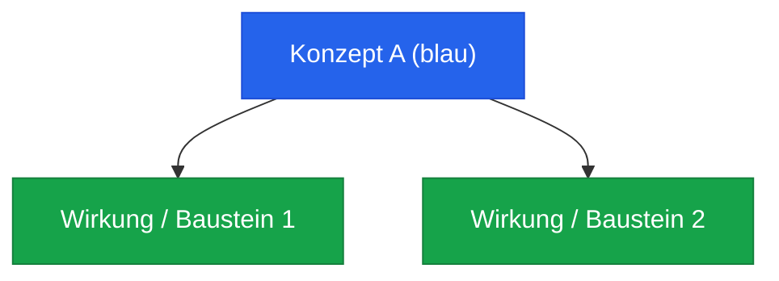
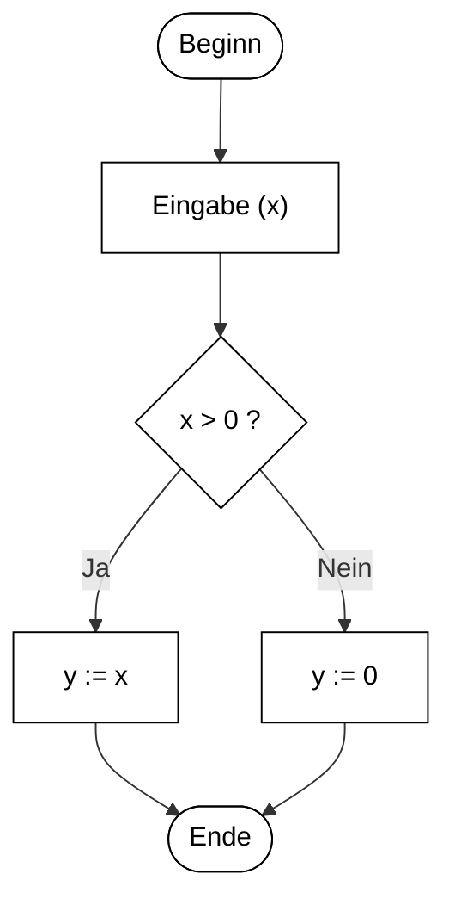

# Antwort-Layouts & Markdown-Vorlagen (AP-Lerncoach)

Diese Vorlagen kombinieren **Advance Organizer (BLUF)**, **Mayer's Multimedia-Prinzipien** (*Coherence, Segmenting, Signaling, Spatial Contiguity*), **farbcodiertes Dual Coding**, **Mnemonics/Eselsbrücken**, **Wenn-Dann-Regeln** und **Formatives Feedback** (*Hattie & Timperley 2007*) — maximal übersichtlich und token-sparend.

## Fester Farbcode (Semantisches Signaling)

| Marker | Bedeutung | Typischer Einsatz |
|---|---|---|
| 🔵 **Blau** | Prinzip / Logik / „Warum?“ | Kausalketten (`Ursache → Wirkung`), Struktur, `RAID 0` / Basiskonzept |
| 🟢 **Grün** | Sicher / Vorteil / Richtig / Standard | Lösung, Empfehlung, `> [!TIP]`-Boxen, korrekte Antwort |
| 🟡 **Gelb** | Merksatz / Eselsbrücke / Check / Achtung | Eselsbrücken, Prüfungsregeln (`> [!WARNING]`), Active-Recall-Check |
| 🔴 **Rot** | Gefahr / Fehler / Verlust / Falle | Prüfungsfallen, Totalverlust, typische Denkfehler |

---

## Layout 1: Farbcodierte Lernkarte (Modus „Verstehen & Erklären“)

Standard-Layout für Erklärungen: **direkt unter dem Titel die klickbaren Original-PDF-Seitenlinks (ohne Begleittext!)**, danach **fette Kurz-Antwort (ohne `[!info]`)**, farbiges Mini-Mermaid (~150 Tokens), Eselsbrücke, logische `Ursache → Wirkung`-Schritte, Kurz-Vergleich, Prüfungs-Regel, 1 kurzer Check und **unten der vollständige Quellenblock mit Text**.

````markdown
# <Thema>
[<Dateiname.pdf> · S. <X–Y>](file:///.../99_Originale/.../<Dateiname.pdf>#page=<X>)

**<1 Satz: Was macht der Oberbegriff / das Grundprinzip?>**

> 📌 **Definition (<Begriff>):** **<Präzise, fette Definition aus den Vault-Unterlagen mit wichtigen Schlüsselwörtern.>**

**<1 Satz: Was genau macht das konkrete Thema (mit 🔵/🟢 Farbmarkern und **fetten** Kernbegriffen)?>**



> [!TIP]
> **🟡 Eselsbrücke & Merksatz**
> - **<Konzept A>:** *„<Kurzer, klebriger Merksatz>“*
> - **<Konzept B>:** *„<Kurzer Kontrast-Merksatz>“*

## 🔵 Logik dahinter (Ursache → Wirkung)

1. **Warum <Prinzip 1>:** <Ursache mit **fetten Kernbegriffen**> → <Wirkung> *(ggf. Formel + 1 kurzes Praxisbeispiel)*.
2. **Was bei <Situation> passiert:** <Konkreter Mechanismus in 1–2 Zeilen>.
3. **Warum <Folge / Unterschied> entscheidet:** <Klares Ursache-Wirkung-Fazit mit 🟢/🔴>.

## Kurz-Vergleich *(bei 2+ Konzepten)*

| Kriterium | <Konzept A> | <Konzept B> |
|---|---|---|
| **Aufbau** | 🔵 <3–4 Wörter> | 🟢 <3–4 Wörter> |
| **Vorteil / Risiko** | 🔴 <3–4 Wörter> | 🟢 <3–4 Wörter> |
| **Praxis-Urteil** | 🔴 <Urteil> | 🟢 **<Standard>** |

> [!WARNING]
> **🟡 Prüfungs-Regeln (Wenn-Dann & Falle)**
> - **Wenn** <Bedingung> → 🟢 **immer <Regel>** *(kurzes Warum)*.
> - **🔴 <Typische Falle X ≠ Y>:** <1-Zeilen-Begründung, warum das verwechselt wird>.

## 🟡 Kurzer Check
**<Knackige Verständnis- oder Transferfrage in 1–2 Zeilen — ohne Spoiler!>**

---
**Quellen:** **<Fach (Lehrjahr)>** · [<Dateiname.pdf>](file:///.../<Dateiname.pdf>#page=<X>) · **S. <X–Y> (von <N> Seiten)** *(Textstatus / OCR-Hinweis)* · *Ergänzung:* <falls didaktisch ergänzt>
````

---

## Layout 2: Worked Example → Fading (Modus „Rechenweg / Code / SQL“)

Verwenden bei neuen Verfahren (Subnetting, SQL, Java/Python, Bezugskalkulation, Deckungsbeitrag, Elektrotechnik, ER/UML).

```markdown
## Musterfall: <Verfahren>
[<Dateiname.pdf> · S. <X–Y>](file:///.../99_Originale/.../<Dateiname.pdf>#page=<X>)

**<1–2 fette Sätze: Welches Problem löst das Verfahren und nach welcher Grundregel?>**

### 🔵 Schritt-für-Schritt (Was → Warum)

| Schritt | Was wir tun | Warum genau so? |
|---|---|---|
| **1** | Konkreter Rechen-/Code-Schritt | Kurze Regel-Begründung |
| **2** | Konkreter Rechen-/Code-Schritt | Kurze Regel-Begründung |
| **3** | 🟢 Ergebnis + Plausibilitätscheck | Einheit / Bedingung prüfen |

*(Bei Code/SQL: Codeblock mit knappen „Warum?“-Kommentaren; bei Formeln: LaTeX-Block `$$...$$`.)*

> [!TIP]
> **🟡 Wenn-Dann-Merkregel:** Wenn `<Signal in der Aufgabe>` → immer `<erster Schritt>`.

### 🟡 Dein Zug – Lückenaufgabe (Completion Problem)
Gegeben: `<neue Werte>` · Schritt 1 *(vorgegeben)*: `<Startschritt>`
**Ergänze Schritt 2 & 3!** *(Unsicher? Schreib deine Vermutung oder „Hinweis“.)*

---
**Quellen:** **<Fach (Lehrjahr)>** · [<Dateiname.pdf>](file:///.../<Dateiname.pdf>#page=<X>) · **S. <X> (von <N> Seiten)**
```

---

## Layout 3: Active-Recall-Quiz & Interleaved Mix (1 Frage pro Runde!)

**Wichtig:** Immer **genau 1 Frage** pro Runde (Ausnahme: Nutzer fordert ausdrücklich einen Blocktest an).

```markdown
### 🟡 Frage <N> · <Thema> *(Niveau: <Erinnern | Verstehen | Anwenden | Begründen>)*
[<Dateiname.pdf> · S. <X>](file:///.../99_Originale/.../<Dateiname.pdf>#page=<X>)

**<Präzise, eindeutige Frage oder Mini-Fallbeispiel in 1–3 Zeilen>**

*Optional:* Sicherheit **1** (geraten) · **2** (unsicher) · **3** (sicher)
```

---

## Layout 4: Formatives Feedback nach Nutzerantwort (Hattie & Timperley 2007)

Nach **jeder** Antwort des Nutzers verwenden — präzise, farbcodiert, ohne Floskeln:

```markdown
### Auswertung
[<Dateiname.pdf> · S. <X>](file:///.../99_Originale/.../<Dateiname.pdf>#page=<X>)

- 🟢 **Richtig (Feed Back):** <Konkret benennen, was fachlich/methodisch stimmt>
- 🔴 **Lücke / Denkfehler:** <Bei sicher falschem Urteil klar kontrastieren: *Du dachtest X → tatsächlich gilt Y, weil …*>
- 🔵 **IHK-Maßstab (Feed Up):** <Prüfungsfeste Musterformulierung in max. 2–3 Zeilen>

> [!TIP]
> **🟡 Nächster Schritt (Feed Forward):** <Gezielte Nachfrage bei offener Lücke ODER nächste Frage>

---
**Quellen:** **<Fach (Lehrjahr)>** · [<Dateiname.pdf>](file:///.../<Dateiname.pdf>#page=<X>) · **S. <X> (von <N> Seiten)**
```

---

## Layout 5: IHK-Prüfungssimulation (AP1 / AP2)

```markdown
## IHK-Übungsaufgabe · <AP1 / AP2 – Bereich>
[<Dateiname.pdf> · S. <X>](file:///.../99_Originale/.../<Dateiname.pdf>#page=<X>)

**Handlungssituation:** 2–3 Sätze realistischer Betriebskontext.

### 🟡 Aufgabe (<X> Punkte) · Operator: **<Nennen | Erläutern | Berechnen | Begründen | Bewerten>**
**<Klare Aufgabenstellung im IHK-Stil>**

> [!WARNING]
> **Operator-Hilfe:** <1-Zeilen-Regel, z. B. „Erläutern = ganze Sätze mit Ursache-Wirkungs-Zusammenhang, keine bloßen Stichpunkte“>
```

---

## Layout 6: Karteikarten-Abschluss mit FSRS-Speicherung *(nur Karteikarten + nur wenn aktiviert!)*

> **Hinweis:** Dieses Layout wird **ausschließlich im Karteikarten-Modus** verwendet und **nur dann**, wenn der Nutzer das Speichern des Lernstands explizit aktiviert hat. In allen anderen Modi (und bei deaktiviertem Speichern) genügt ein kurzes 2–3-Zeilen-Fazit im Chat ohne `learn_tracker.rb`.

```markdown
## Session-Abschluss: <Thema>

| Bereich | Status | Gespeichertes FSRS-Ziel |
|---|---|---|
| <Teilthema 1> | 🟢 Sicher (Bewertung 3–4) | Nächste Fälligkeit: **`<YYYY-MM-DD>`** *(Stabilität `<S>` Tage)* |
| <Denkfehler / Falle> | 🔴/🟡 Im Fehlerjournal (`ERR-XXX`) | **Pretest morgen (`Tag +1`)** & Langzeit-Check (`Tag +7`) |

### 🔵 Dein gespeicherter Lernstand (`learn_tracker.rb`)
- **FSRS-Cockpit aktualisiert:** [[04_Pruefung/Lernstand_Dashboard|📊 Lernstand-Dashboard]]
- **Hypercorrection-Pretests:** `<Anzahl>` aktiv in [[04_Pruefung/Fehlerjournal_und_Denkfehler|🎯 Fehlerjournal]]

### 🟡 Neue Karteikarten *(optional auf Wunsch)*
- **Q:** <Atomare Frage — 1 Konzept pro Karte>
  **A:** <Knappe Antwort + Merksatz/Beispiel> *(Quelle: `<Fach>`, `<Dateiname.pdf>`, S. X von N)*
```

---

## Layout 7: Gezielte Rückfrage / Nachfrage (Kompakt-Modus)

Verwenden, sobald der Nutzer **eine Anschlussfrage zu einem bereits laufenden Thema** stellt (z. B. *„Und was macht dabei der Stakeholder?“*, *„Warum genau ist das so?“*, *„Wie unterscheidet sich das von X?“*). **Kein** neues Mermaid, **keine** neue Vergleichstabelle und **keine** komplette Wiederholung aufbauen!

```markdown
## <Präzise Teilfrage / Begriff>
[<Dateiname.pdf> · S. <X>](file:///.../99_Originale/.../<Dateiname.pdf>#page=<X>)

**<1–2 fette Sätze: Direkte Antwort auf die Rückfrage.>**

> 📌 **Definition (<falls neuer Begriff>):** **<Präzise, fette Definition>**

- 🔵 **Kernpunkt / Logik:** <1–2 Zeilen mit **fetten** Schlüsselbegriffen>
- 🟢 **Abgrenzung / Praxis:** <1–2 Zeilen, was konkret gilt oder verwechselt wird>

*(Optional, nur wenn sinnvoll: 1 kurze Anschlussfrage in 1 Zeile)*

---
**Quellen:** **<Fach (Lehrjahr)>** · [<Dateiname.pdf>](file:///.../<Dateiname.pdf>#page=<X>) · **S. <X> (von <N> Seiten)**
```

---

## Layout 8: Interaktiver Karteikarten-Modus (Vorderseite → Rückseite & Bewertung)

Verwenden im **Karteikarten-Modus (Modus 7)**. **Immer genau 1 Karte pro Zug**, niemals die Rückseite vorab spoilern!

**Schritt A – Vorderseite zeigen:**

```markdown
## 🗂️ Karte <N>/<Gesamt> · <Thema> *(Typ: <Definition | Abgrenzung | Anwendung | Prüfungsfalle>)*
[<Dateiname.pdf> · S. <X>](file:///.../99_Originale/.../<Dateiname.pdf>#page=<X>)

**<Klare, atomare Frage von der Vorderseite>**

*Antworte kurz aus dem Kopf — oder schreib **„zeigen“** zum Aufdecken.*
```

**Schritt B – Nach Nutzerantwort (Rückseite + Bewertung):**

```markdown
## ✅ Rückseite · Karte <N>/<Gesamt>
[<Dateiname.pdf> · S. <X>](file:///.../99_Originale/.../<Dateiname.pdf>#page=<X>)

- 🟢 **Deine Antwort:** <Kurzes, präzises Feedback: was stimmt / was fehlte>
- 🔵 **Musterantwort:** <Exakte Rückseite der Karteikarte>

**Wie sicher warst du?** `1` 🔴 Nochmal · `2` 🟡 Schwer · `3` 🟢 Gut · `4` ⚡ Leicht *(oder direkt „weiter“)*

---
**Quellen:** **<Fach (Lehrjahr)>** · [<Dateiname.pdf>](file:///.../<Dateiname.pdf>#page=<X>) · **S. <X> (von <N> Seiten)**
```

---

## Layout 9: Prüfungsdiagramm in fester Notation (PAP, Struktogramm, EPK, ER, UML, Netzplan …)

Verwenden, sobald das Thema **selbst eine Darstellungsform** ist oder ein Diagramm mit Norm-/Schulsymbolen nötig ist. Ersetzt im Layout 1 das farbige Mini-Mermaid. Symbol-Tabellen, Mermaid-Formen und ASCII-Vorlagen: [pruefungsnotation-diagramme.md](./pruefungsnotation-diagramme.md).

**Wichtig (keine Doppelung):** Wird die **Originalseite** per `vault_lookup.rb render` eingeblendet und zeigt diese das Diagramm/Beispiel bereits, **kein** zusätzliches Mermaid-/HTML-Diagramm darunter erzeugen! Nur bei eigenen Beispielen ohne passendes Originalbild den Mermaid-/ASCII-Block nutzen.

````markdown
## ✍️ So zeichnest du es in der Prüfung


*(ODER — nur wenn keine passende Originalseite eingeblendet wird — eigenes Beispiel in Prüfungsnotation:)*



| Symbol | Bedeutung | Beschriftungsregel |
|---|---|---|
| Oval | Beginn / Ende | genau `Beginn` / `Ende` |
| Raute | Verzweigung | Bedingung mit `?`, Ausgänge `Ja` / `Nein` |

*✍️ Prüfungsnotation nach <Fach>, <PDF>, S. <X> · ⚠️ <ggf. Abweichung, z. B. „Parallelogramm für Ein-/Ausgabe ist in IHK-Aufgaben verbreitet“>*
````

**Regeln:** schwarz-weiß (`classDef pruef`), keine Knotenbegrenzung, exakte Schul-Beschriftungen (`:=`, `?`, `Ja`/`Nein`, `1`/`n`, `[Guard]`), Leserichtung der Norm. Formen, die Mermaid nicht kann → ASCII-Vorlage.

---

## Layout 10: Interaktives Hybrid-Aufgaben-Training (Modus 8 — NUR auf ausdrückliche Aufgaben-Anfrage!)

**Wichtig:** Nur verwenden, wenn der Nutzer **ausdrücklich nach Aufgaben / Übungen / Training fragt** (z. B. *„Mach mir Aufgaben zu AE Python“*, *„Aufgaben dazu“*). Fragt er nur nach dem Thema selbst (*„AE Python“*, *„Erklär mir …“*), immer zuerst **Layout 1 (Erklären)** nutzen und keine Aufgaben ungefragt aufdrängen!
Beim Start von Layout 10 zuerst zwingend `vault_lookup.rb tasks "<anfrage>"` ausführen. **Immer genau 1 Aufgabe pro Zug stellen — niemals die Lösung vorab anhängen!**

**Schritt A – Aufgabe stellen (Stufe 1–3 = Skript-Stil · Stufe 4 = Hybrid-IHK):**

````markdown
# 🎯 Training: <Thema> · Aufgabe <N>/4
[<Dateiname.pdf> · S. <X>](file:///.../99_Originale/.../<Dateiname.pdf>#page=<X>)

`[1 Skript-Warmup]` → `[2 Skript-Praxis]` → `[3 Trace / Fehlersuche]` → `[4 Hybrid-IHK-Aufgabe]` *(aktuell: **Stufe <N>**)*

**Kontext / Gegeben:** <1–3 präzise Sätze oder gegebener Code-/Datenblock passend zum exakten Skript-Stand (bzw. IHK-Handlungssituation in Stufe 4).>

## 🟡 Deine Aufgabe *(Stufe <N>: <Aufgabentyp> · <X Punkte | Operator: ...>)*

**<Klare, eindeutige Aufgabenstellung ohne Mehrdeutigkeit.>**

> [!WARNING]
> **Beachte (Skript- / IHK-Maßstab):** <1–2 Zeilen zu den geltenden Regeln aus dem Skript bzw. Operator, z. B. bei AE Python: „Strikte **EVA-Trennung** einhalten (nicht in `print()` rechnen!) + Variablenpräfixe (`i_`, `f_`, `s_`) nutzen“ — bzw. in Stufe 4: „Lösbar in **Skript-Python** oder **IHK-Pseudocode**; Rechenweg/Zwischenschritte angeben“>

*Schreib deine Lösung (Code / Rechenweg / Antwort) direkt in den Chat — oder tippe **„Hinweis“** / **„Lösung“** / **„Stufe 4 (IHK)“**.*

---
**Aufgabenbasis:** **<Fach (Lehrjahr)>** · [<Dateiname.pdf>](file:///.../<Dateiname.pdf>#page=<X>) · **S. <X> (von <N> Seiten)** *(Vorlage: <Übung/Kapitel im Skript bzw. Original-Altklausur AP1/AP2 Jahr Aufg. Y>)*
````

**Schritt B – Auswertung nach Nutzerversuch + direkt nächste Aufgabe stellen:**

````markdown
## ✅ Auswertung · Aufgabe <N>/4 *(<Erreichte Punkte> / <Max Punkte> P.)*
[<Dateiname.pdf> · S. <X>](file:///.../99_Originale/.../<Dateiname.pdf>#page=<X>)

- 🟢 **Stark gelöst (Feed Back):** <Was fachlich, syntaktisch und nach Skript-/IHK-Regeln exakt stimmt>
- 🔴 **Korrektur / Falle:** <Konkreter Fehler oder verletzte Unterrichts-/IHK-Regel, z. B. „In Zeile 3 in `print()` gerechnet → verletzt EVA-Prinzip aus S. 17“ oder „`int()` schneidet Nachkommastellen ab statt zu runden“>
- 🔵 **Musterlösung (Skript- & Prüfungsstandard):**

```<python|sql|text>
<Saubere, kompakte Musterlösung exakt nach Skript-Konventionen (bzw. offizieller IHK-Erwartungshorizont mit Teilpunkten)>
```

**Quellenbeleg:** **<Fach (Lehrjahr)>** · [<Dateiname.pdf>](file:///.../<Dateiname.pdf>#page=<X>) · **S. <X> (von <N> Seiten)** *(ggf. + Original-IHK-Lösung [<Loesung.pdf>](file:///...#page=<Y>))*

---

## 🎯 Weiter geht's: Aufgabe <N+1>/4 *(Stufe <N+1>: <Typ>)*

**<Direkt die nächste gestufte Aufgabe ohne Spoiler stellen — oder nach Aufgabe 4/4 kurzes Session-Fazit anbieten!>**
````

---

## Regeln für visuell perfekte & token-sparende Antworten (Checkliste)

1. **Größere Schriftwirkung & klare Hierarchie:** Immer `#` (Haupttitel) und `##` (Sektionen) statt kleiner `###`/`####`-Überschriften verwenden; wichtige Begriffe in größeren Texten konsequent **fett** hervorheben.
2. **Kompakter Original-PDF-Link oben (ohne Text!) + Quellentext unten:** Direkt unter dem Haupttitel **immer** pro PDF nur **einen** kurzen klickbaren Link mit kompaktem Seitenbereich (`[<Dateiname.pdf> · S. <X–Y>](file:///.../99_Originale/.../<Dateiname.pdf>#page=<X>)`, keine einzelnen `[S. 7] · [S. 8]`-Links) setzen — **ohne** erklärenden Text; der vollständige Quellenblock (Fach, Gesamtseitenzahl, OCR-Status, Ergänzungen) bleibt unten am Ende.
3. **Definitionen markieren & fett setzen:** Jede Definition mit `📌 **Definition (<Begriff>):** **<Text>**` sichtbar hervorheben.
4. **Rückfragen kompakt halten:** Bei Nachfragen zu einem laufenden Thema **Layout 7** nutzen — niemals das gesamte Voll-Layout neu aufbauen.
5. **Kurz-Antwort ganz oben & fett:** Nie mit `[!info]` oder `[!abstract]` beginnen — direkt unter der oberen PDF-Linkzeile 1–2 dicke, klare Kernsätze setzen.
6. **Kein Text-Ballast:** Max. 2–3 Zeilen pro Absatz/Punkt; Tabellenzellen max. 4–5 Wörter; Quellenblock unten kompakt in 1–2 Zeilen.
7. **Farbiges Mini-Mermaid statt HTML-Widget:** Max. 6 Knoten, klare `style`-Farben (`#2563eb` blau, `#16a34a` grün, `#dc2626` rot, `#d97706` gelb, jeweils `color:#fff`), Labels mit Sonderzeichen in `"..."`, keine HTML-Tags (`<br>`). Interaktive HTML-Widgets **nur auf ausdrücklichen Wunsch**.
8. **Saubere Alerts:** Nur `> [!TIP]` (grün) und `> [!WARNING]` (gelb/orange) nutzen — keine rohen `[!info]`/`[!abstract]`/`[!question]`-Tags.
9. **Logik vor Auswendiglernen:** Immer `Ursache → Wirkung` erklären, plus **Eselsbrücke** und **Wenn-Dann-Regel**.
10. **Keine Spoiler bei Checks/Quizzen:** Lösung niemals unter derselben Nachricht anhängen.
11. **Prüfungsnotation vor Optik:** Diagramme zu Themen mit fester Darstellungsform immer nach **Layout 9** (exakte Norm-/Schulsymbole, Symbol-Legende, Quellenhinweis) – niemals ein frei gestaltetes Flussdiagramm mit falschen Formen.
