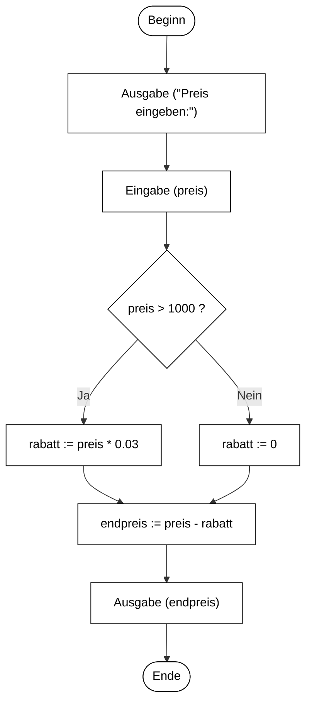
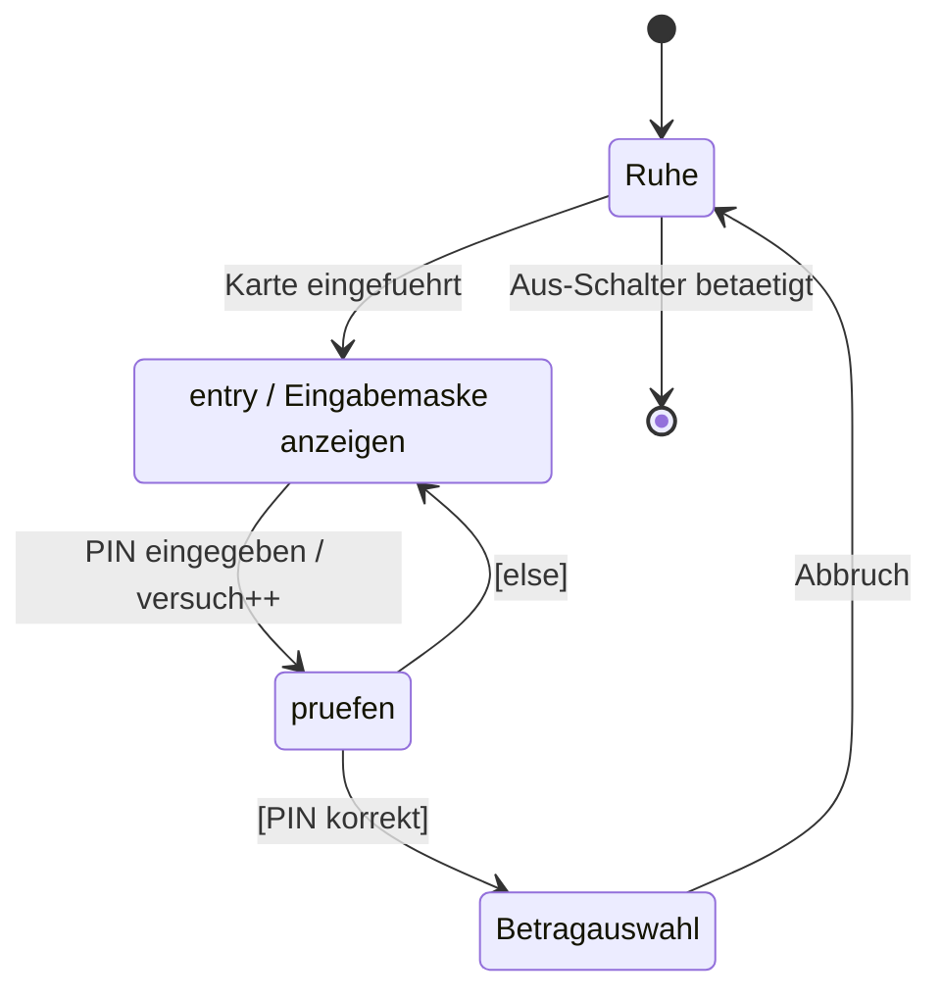
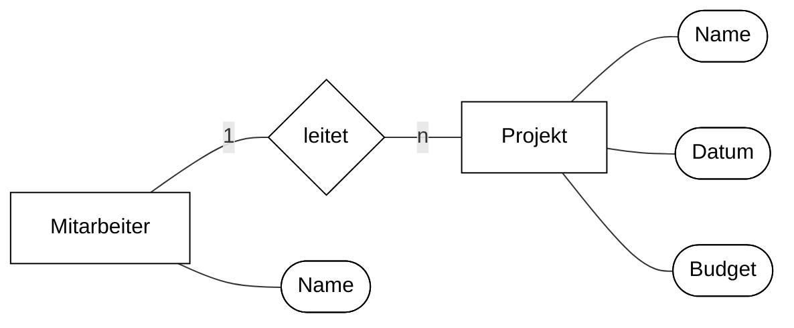

# Prüfungsnotation für Diagramme (Pflicht bei jedem Fach-Diagramm)

> **Grundregel:** Gibt es für ein Thema eine **festgelegte Darstellungsform** (Norm, Schul-/IHK-Notation), dann muss jedes Diagramm in der Antwort **genau diese Notation** zeigen – so, wie der Nutzer es in der Klausur/IHK-Prüfung **selbst zeichnen muss**. Ein „hübsches“ Lern-Flussdiagramm mit falschen Symbolen ist **verboten**, weil es falsche Formen einprägt.

Gilt für: PAP, Struktogramm, Datenflussplan, EPK/eEPK, BPMN, UML (Aktivität, Zustand, Use-Case, Klasse), ER-Modell, Netzplan (Vorgangsknoten), Entscheidungstabelle, Gantt/Balkendiagramm, Logikschaltungen/Wahrheitstabellen sowie jede weitere Darstellung, die im Vault mit festen Symbolen gezeigt wird.

---

## 1. Ablauf bei jedem Diagramm (immer in dieser Reihenfolge)

1. **Notation im Vault belegen & bei Notations-/Überblicksfragen sofort rendern:**
   Die Belegseite per `vault_lookup.rb` laden (Tabelle unten nennt die Belegseiten). Handelt es sich um ein **neues Diagramm-Thema, einen Symbol-Überblick oder eine Notationsfrage** (*„Was ist ein ER-Diagramm / PAP / EPK …?“*), **immer** die Originalseite rendern:
   ```bash
   ruby .agents/skills/ap-lerncoach/scripts/vault_lookup.rb render "<quelle>" "<seite(n)>" --out "<Artefakt-Ordner>/notation"
   ```
   *(Token-Sparregel: Das gerenderte PNG direkt per `` einbetten, aber **nicht** mit `read_file` in den KI-Kontext laden, solange Text/Spickzettel die Symbole bereits belegen — das spart 100 % der Bild-Input-Tokens! Nur bei echten OCR-Unklarheiten `partial`/`ocr_error`/`missing` oder fehlendem Spickzettel auch selbst ansehen.)*
2. **Originalseite ODER Diagramm-Nachbau (keine Doppelung!):**
   - **Neues Thema / Symbol-Überblick / Notationsfrage:** **Immer und ausschließlich** die gerenderte Originalseite als Bild einbetten (``) — **kein** zusätzliches Mermaid-/HTML-Diagramm darunter!
   - **Eigenes/neues Beispiel ohne passendes Originalbild** (z. B. frische Übungsaufgabe): Notationsgetreues Diagramm per Mermaid (nur Formen aus der Tabelle unten) oder ASCII-Vorlage (Abschnitt 3) erstellen — ohne `render` und ohne HTML-Diagramm.
3. **Symbol-Legende direkt darunter:** Kurze Tabelle `Symbol → Bedeutung → Beschriftungsregel` (z. B. EPK-Ereignis = Sechseck, *Substantiv + Verb im Perfekt*).
4. **Kennzeichnung:** Unter das Bild bzw. Diagramm: `✍️ Prüfungsnotation nach <Norm/Schulquelle, S. X>` – und bei bewusster Vereinfachung (z. B. Mermaid kann Form nicht exakt) ehrlich: `⚠️ In der Prüfung zeichnest du: <echte Form>`.

### Stil-Regeln für Prüfungsdiagramme
- **Schwarz-weiß wie auf Papier:** Knoten `fill:#fff,stroke:#000,color:#000`. Farbe nur dort, wo die Schulnotation sie selbst nutzt (z. B. **kritischer Weg rot**) – keine Deko-Farbcodes (🔵🟢) in Prüfungsdiagrammen.
- **Exakte Beschriftungen übernehmen:** `Beginn`/`Ende`, `Ja`/`Nein`, `:=` für Zuweisung, `?` in der Bedingung, Kardinalitäten `1`/`n`/`m`, Guards in `[ ]`.
- **Leserichtung der Norm** einhalten (PAP/EPK: oben → unten; Netzplan: links → rechts).
- Lern-/Konzeptgrafiken (z. B. Ursache-Wirkungs-Kette, Phasenübersicht) dürfen weiter farbig sein – aber **nie** mit Formen, die einer Prüfungsnotation widersprechen.

---

## 2. Notations-Spickzettel je Diagrammtyp (Vault-belegt)

### 2.1 Programmablaufplan (PAP) – DIN 66001
Beleg: **AE (1. LJ)** `01_Algorithmus_Programm_Software_EVA` **S. 8** (Grundsymbole + Beispiel), **S. 11** (weitere Symbole, handschriftlich), **S. 42** (DIN 66001), Praxisbeispiel **S. 9**.

| Symbol (Prüfung) | Bedeutung | Mermaid-Form |
|---|---|---|
| Oval / Rechteck mit runden Enden | `Beginn` / `Ende` | `A([Beginn])` |
| Rechteck | Anweisung/Verarbeitung, auch `Eingabe (preis)` / `Ausgabe (...)` laut Schulblatt | `B[rabatt := 0]` |
| Parallelogramm | Ein-/Ausgabe – **in IHK-Prüfungen verbreitet** (ZP-H17), nicht normkonform | `C[/Eingabe anzahl/]` |
| Raute mit `?` | Verzweigung, Ausgänge `Ja` / `Nein` beschriftet | `D{preis > 1000 ?}` |
| Rechteck mit doppelten Seitenlinien | Unterprogramm-Aufruf (z. B. `Mwst`) | `E[[Mwst]]` |
| Kreis mit Buchstabe | Konnektor (Fortsetzung an anderer Stelle) | `K((A))` |
| Eckige Klammer mit Linie `[…` | Kommentar | Mermaid kann es nicht → `%% Kommentar` + Hinweis |
| Pfeile | Ablaufrichtung oben → unten | `-->`, `-- Ja -->` |

Regeln: Zuweisung `:=`, **kein `;`** (nur Pseudocode), Deklaration wird im PAP meist nicht dargestellt (S. 11).



### 2.2 Struktogramm (Nassi-Shneiderman)
Beleg: **AE (1. LJ)** `01_Algorithmus_Programm_Software_EVA` **S. 4–7** (S. 7 Grundaufbau), **S. 12–16** (Fallauswahl), **S. 29** (Schleifen).
Mermaid **kann das nicht** → immer **ASCII-Block** (Vorlage 3.1). Merkmale: ein geschlossener Block; Sequenz = Zeilen untereinander; Verzweigung = Dreieck mit Bedingung + `Ja` links / `Nein` rechts; leerer Zweig bleibt leeres Feld; Schleife = Block mit Bedingungsbalken.

### 2.3 Datenflussplan (DFP) – DIN 66001
Beleg: **AE (1. LJ)** `01_Algorithmus_Programm_Software_EVA` **S. 42–43**.

| Symbol | Bedeutung | Mermaid-Form (Näherung) |
|---|---|---|
| Rechteck mit schräger Oberkante | Eingabeeinheit (manuelle Eingabe) | `A[/manuelle Eingabe/]` + Hinweis „schräge Oberkante“ |
| Rechteck | Verarbeitung (allgemein) | `B[Erfassungsprogramm]` |
| Trapez (oben breiter) | manuelle Verarbeitung | `C[\manuell/]` |
| Rechteck mit gewellter Unterkante | Daten auf Schriftstück (Ausdruck) | `D[Einlieferliste 📄]` + Hinweis |
| Sechseck-artig, rechts rund | Bildschirmausgabe | `E{{Bildschirm}}` + Hinweis |
| Kreis mit Strich unten rechts | Speicher mit sequenziellem Zugriff (Magnetband) | `F((Band))` + Hinweis |
| liegender Zylinder | Speicher mit direktem/wahlfreiem Zugriff (Festplatte) | `G[(Festplatte)]` |
| Parallelogramm | Daten (allgemein) | `H[/Daten/]` |

Wenn mehrere Näherungen nötig sind → **Originalseite S. 42 einbetten** (zeigt alle Normformen).

### 2.4 EPK / eEPK
Beleg: **BGWP (2. LJ)** `BGWP_2LJ_Mitschrift` **S. 7–11** (Grundlagen, Konnektoren, eEPK), **S. 16–22** (Beispiele/Lösungen).

| Symbol | Bedeutung | Beschriftung | Mermaid-Form |
|---|---|---|---|
| Sechseck | **Ereignis** (passiv, „Was ist passiert?“) | Substantiv + Verb im **Perfekt** („Bestellung ist eingegangen“) | `E1{{Bestellung ist eingegangen}}` |
| abgerundetes Rechteck | **Funktion** (aktiv, „Was soll jetzt gemacht werden?“) | Substantiv + Verb im **Infinitiv** („Ware vorbereiten“) | `F1(Ware vorbereiten)` |
| Kreis mit `XOR` / `∧` / `∨` | Verknüpfungsoperator | – | `K1((XOR))` |

Regeln (`BGWP_2LJ_Mitschrift` S. 7–9): Leserichtung **oben → unten**; jede EPK **beginnt und endet mit mind. einem Ereignis**; Ereignis und Funktion wechseln sich grundsätzlich ab; alle Symbole mit Linien verbunden.
- **Verzweigungsverbot nach Ereignis (Prüfungsfalle #1):** Da Ereignisse passiv sind, dürfen nach einem Ereignis **niemals `XOR`- oder `OR` (`∨`)-Gabelungen** folgen (`BGWP_2LJ_Mitschrift` S. 8) — Entscheidungen stehen ausschließlich nach einer **Funktion** (`AND` / `∧` nach Ereignis ist zulässig).
- **eEPK-Zuordnungsregel (S. 7–8, 11):** **Organisationseinheiten** (gestrichelte Linie) und **Informationsobjekte** (Datenflusspfeil: `IO → Funktion` = Lesen, `Funktion → IO` = Schreiben) dürfen **nur an Funktionen**, niemals an Ereignisse angebunden werden. Formen vor dem Zeichnen auf **S. 11** prüfen (nicht raten).

### 2.5 UML-Zustandsdiagramm
Beleg: **AE (2. LJ)** `AE_2LJ_Jac_Mitschrift` **S. 10–14** (Notation inkl. beschriftetem Geldautomat-Beispiel), Fehlerregeln **S. 18–19** (u. a. „nur 1 Startpunkt“).
Mermaid `stateDiagram-v2` entspricht der Notation gut: Startzustand = gefüllter Kreis `[*] -->`, Endzustand = Kreis mit Punkt `--> [*]`, Zustand = abgerundetes Rechteck, Transition beschriftet **`Ereignis [Guard] / Effekt`**, interne Aktionen `entry / …`, `do / …`, `exit / …` im Zustand, Entscheidung = Raute (`state x <<choice>>`), Rahmen `sm <Name>`.



### 2.6 UML-Aktivitätsdiagramm (AP1-Schwerpunkt)
Beleg: Übersicht **AE (2. LJ)** `AE_2LJ_Jac_Mitschrift` **S. 5–6** (Diagrammtypen); vor dem Zeichnen Seiten mit Symbolen laden. Mermaid hat kein Aktivitätsdiagramm → `flowchart` mit: Startknoten gefüllter Kreis `S(( )):::start`, Aktion = abgerundetes Rechteck `A(Aktion)`, Entscheidung/Zusammenführung = **leere** Raute mit Guards `[Bedingung]` an den Kanten, Gabelung/Vereinigung = schwarzer Balken (Hinweis „⚠️ in der Prüfung dicker schwarzer Balken“), Endknoten = Kreis mit Punkt `E(((●)))`.

### 2.7 ER-Modell (Chen-Notation laut Unterricht)
Beleg: **AE (2. LJ)** `AE_2LJ_Kislik_Skript` **S. 58–61** (S. 60 Beispiel Mitarbeiter–leitet–Projekt, S. 61 rekursive Beziehung).
**Kein Mermaid `erDiagram`** (das ist Krähenfuß-Notation und weicht vom Unterricht ab!) → `flowchart`:

| Symbol | Bedeutung | Mermaid-Form |
|---|---|---|
| Rechteck | Entität | `M[Mitarbeiter]` |
| Raute | Beziehung (Verb) | `R{leitet}` |
| Ellipse | Attribut | `A1([Name])` |
| Zahl an der Linie | Kardinalität `1`, `n`, `m` | `M ---|1| R`, `R ---|n| P` |



### 2.8 Netzplan (Vorgangsknoten-Netzplan)
Beleg: **BGWP (1. LJ)** `Bgwp_schredl` **S. 37–45** (S. 41 fertiger Netzplan, S. 42 Knotenraster, S. 43 „2. Methode“, S. 45 Prüfungsaufgabe).
Knoten-Layout exakt nach S. 41–42 (Vorlage 3.2): **über** dem Knoten links `FAZ`, rechts `FEZ`; **im** Knoten oben `Nr | Vorgangsbezeichnung`, unten `Dauer | GP | FP`; **unter** dem Knoten links `SAZ`, rechts `SEZ`. Pfeile links → rechts, **kritischer Weg rot** (GP = 0).

**Zwei Rechenkonventionen sauber trennen:**
- **IHK-Standard / Methode 1 (`Start = 0`, `Bgwp_schredl` S. 38–42, 45):** `FEZ = FAZ + D`, `SAZ = SEZ - D`, `GP = SAZ - FAZ`, `FP = min(FAZ_Nachfolger) - FEZ`.
- **BGWP-Schulvariante „2. Methode“ (`Start = Tag 1`, `Bgwp_schredl` S. 43):** `FEZ = FAZ + D - 1`, `SAZ = SEZ - D + 1`, `GP = SAZ - FAZ`, `FP = min(FAZ_Nachfolger) - FEZ - 1`. Bei Aufgaben immer angeben, welche Methode gilt (für IHK-Prüfungen gilt Standard `Start = 0`).

### 2.9 Weitere feste Darstellungen
- **BPMN 2.0** (AP1 neu): Beleg `BGWP_2LJ_Mitschrift` **S. 24–25** – vor dem Zeichnen Symbolseiten per `vault_lookup.rb topic "Business Process Model and Notation BPMN" --compact` laden und Formen (Start/Ende, Task, Gateway XOR/AND/OR, Pool/Lane) **aus der Quelle** übernehmen. **BGWP-Unterrichtskonvention:** Jedes BPMN-Diagramm erhält mindestens einen **Pool mit einer Lane**; Aktivitäten im Format *Substantiv + Verb* (in OMG-BPMN 2.0 / IHK-Einzelprozessen ist der Pool bei nur einem Teilnehmer optional).
- **Entscheidungstabelle**: `Bgwp_schredl` **S. 24–27** → Markdown-Tabelle im Schul-Layout (Bedingungen/Aktionen × Regeln R1…Rn, `J`/`N`/`X`).
- **Logikschaltungen**: `Grundausbildung_IT` **S. 1** → Wahrheitstabelle mit Spalten `E1 | E2 | A`.
- **UML-Use-Case/Klasse, Gantt**: nur nach Laden der Belegseiten; Formen aus der Quelle übernehmen.

> **Unbekannte Notation?** Nicht raten: Thema per `find` suchen, Originalseite rendern, Formen ablesen. Steht die Notation nicht im Vault, das als *Ergänzung (allgemeiner Standard, z. B. DIN 66001 / UML 2.5)* kennzeichnen.

---

## 3. ASCII-Vorlagen für Formen, die Mermaid nicht kann

### 3.1 Struktogramm (Vorlage nach S. 7)
```text
┌──────────────────────────────────────────────┐
│ Beginn                                       │
├──────────────────────────────────────────────┤
│ rabatt := 0                                  │
├──────────────────────────────────────────────┤
│ Ausgabe ("Preis eingeben:")                  │
├──────────────────────────────────────────────┤
│ Eingabe (preis)                              │
├──────────────────────────────────────────────┤
│ ╲               preis > 1000 ?             ╱ │
│ Ja ╲                                    ╱ Nein│
├──────────────────────┬───────────────────────┤
│ rabatt := preis*0.03 │                       │
├──────────────────────┴───────────────────────┤
│ endpreis := preis - rabatt                   │
├──────────────────────────────────────────────┤
│ Ausgabe (endpreis)                           │
├──────────────────────────────────────────────┤
│ Ende                                         │
└──────────────────────────────────────────────┘
```
Kopfgesteuerte Schleife: Bedingungsbalken oben, Schleifenrumpf eingerückt rechts darunter (`│ solange i <= 10 │` + eingerückter Block); fußgesteuert: Balken unten.

### 3.2 Netzplan-Vorgangsknoten (Vorlage nach S. 41)
```text
FAZ 20                       FEZ 23
┌──────┬────────────────────────┐
│ B    │ Erdaushub Fundamente   │
├──────┼────────┬───────────────┤
│ 3    │ GP 0   │ FP 0          │
└──────┴────────┴───────────────┘
SAZ 20                       SEZ 23
```
In der Prüfung stehen die Werte **ohne** die Kürzel – Kürzel nur zum Lernen dazuschreiben und darauf hinweisen.

### 3.3 Entscheidungstabelle
```text
| Bedingungen / Aktionen | R1 | R2 | R3 | R4 |
|------------------------|----|----|----|----|
| B1: ...                | J  | J  | N  | N  |
| B2: ...                | J  | N  | J  | N  |
| A1: ...                | X  |    |    |    |
| A2: ...                |    | X  | X  |    |
```
